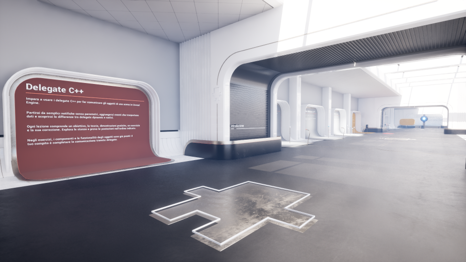
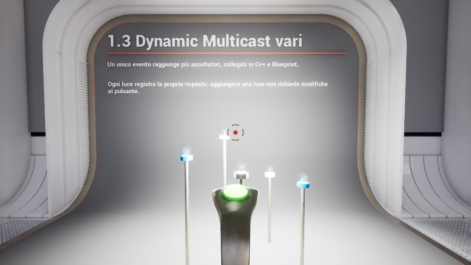
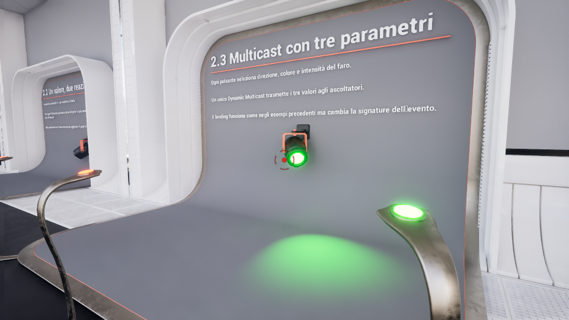
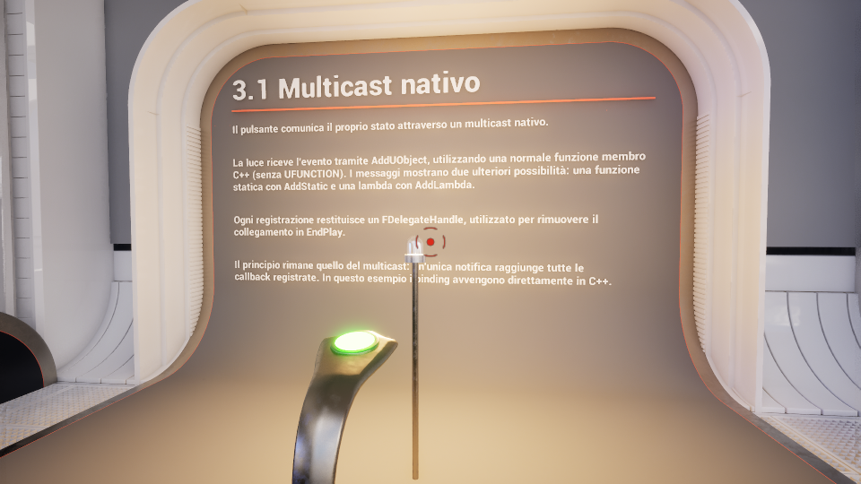
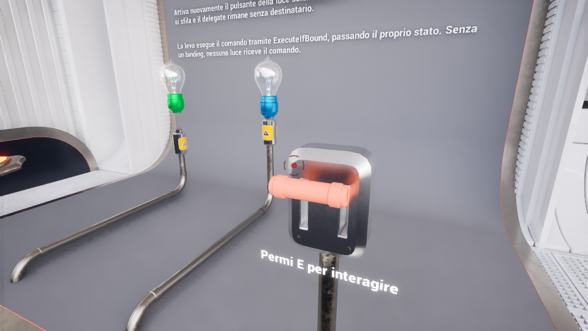
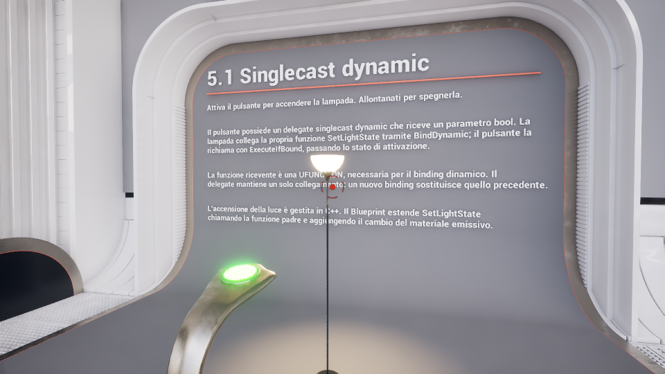

# Unreal C++ Delegates

  

Un progetto didattico interattivo per approfondire i delegate C++ in Unreal Engine,
dagli eventi multicast alle callback singlecast, con esempi in C++ e Blueprint.

Esplora le dimostrazioni, completa gli esercizi e confronta il tuo lavoro
con le soluzioni disponibili.

## A chi è rivolto

Il progetto è rivolto a sviluppatori che conoscono già le classi C++ e i Blueprint di Unreal Engine.

Negli esercizi, la logica delle interazioni e degli effetti visivi è già
predisposta: il lavoro si concentra sulla dichiarazione, sul binding
e sull'esecuzione dei delegate.

## Cosa imparerai

- Distinguere delegate nativi e dynamic, multicast e singlecast.
- Definire signature senza parametri e con più parametri.
- Creare binding in C++ e integrare i delegate dynamic con Blueprint.
- Utilizzare valori di ritorno nei singlecast e callback di completamento.
- Gestire la registrazione e la rimozione dei binding nei multicast nativi

## Scarica il progetto

[Scarica i progetti ZIP dalla pagina Releases](https://github.com/deriusim-one/UnrealCPPDelegates/releases/latest)

- **Studente:** dimostrazioni complete ed esercizi da svolgere.
- **Soluzioni:** progetto completo con tutti gli esercizi risolti.

Estrai l'archivio e apri `DelegatesCourse.uproject`.
Al primo avvio, consenti la compilazione dei moduli C++ se richiesta.

## Percorso delle lezioni

### 1. Dynamic Multicast senza parametri

  

Un pulsante notifica l'attivazione e la disattivazione senza conoscere
gli oggetti in ascolto. Ogni ricevitore collega la propria risposta
agli eventi del pulsante.

Le dimostrazioni introducono la dichiarazione della signature,
il broadcast e i binding in C++ e Blueprint, passando da una singola
luce a più ricevitori collegati allo stesso emittente.

**Esercizio:** completa i delegate di una pedana e i relativi binding
per avviare e arrestare insieme degli ingranaggi realizzati in C++
e un logo animato in Blueprint.

### 2. Dynamic Multicast con parametri

  

Un dimmer trasmette un valore per aggiornare una barra di progresso,
una percentuale e degli indicatori luminosi, con ricevitori collegati
in C++ e Blueprint.

Il percorso estende poi lo stesso principio a un evento con tre parametri:
colore, intensità e orientamento di un faretto vengono trasmessi insieme
e utilizzati dal ricevitore per aggiornare la scena.

**Esercizio:** completa un delegate con due parametri, mesh e colore,
e i binding in C++ e Blueprint per aggiornare un ologramma e verificare
la combinazione che apre una porta.

### 3. Multicast nativi

  

Il modello multicast viene applicato interamente in C++.
La luce riceve la notifica in una normale funzione membro tramite
AddUObject; la dimostrazione include anche il collegamento a una
funzione statica con AddStatic e a una lambda con AddLambda.

Ogni registrazione restituisce un FDelegateHandle, utilizzato
per identificare e rimuovere il collegamento in EndPlay.

**Esercizio:** collega una pedana agli ingranaggi tramite AddUObject
e utilizza l'handle della registrazione per rimuovere il binding
alla fine del ciclo di vita dell'Actor.

### 4. Singlecast nativi

  

La console mantiene un solo binding alla volta: collegare una nuova
lampada sostituisce il destinatario precedente. La leva esegue
il comando sulla lampada attualmente associata.

Un secondo esempio introduce il valore di ritorno: il dispenser
interroga un delegate per verificare se può generare una nuova bomba.

**Esercizio:** completa il delegate della console di un ascensore.
Il piano richiesto viene passato come parametro e il valore di ritorno
stabilisce se autorizzare il movimento.

### 5. Singlecast dinamici

  

Un pulsante trasmette il proprio stato a una lampada tramite un
singlecast dinamico con parametro bool.

Le dimostrazioni mostrano il binding in C++ con BindDynamic verso
una UFUNCTION e l'assegnazione di una callback da Blueprint.
La lampada combina inoltre il comportamento C++ con un'estensione
visiva realizzata in Blueprint.

**Esercizio finale:** completa il passaggio, la memorizzazione,
l'esecuzione e la pulizia delle callback di una stazione di ricarica.

Il sistema deve ricaricare la batteria, collegarla alla lampada,
mantenerla accesa durante la scarica e ripetere automaticamente
il ciclo, coordinando le operazioni C++ con le animazioni Blueprint.

## Requisiti

Si consiglia **Unreal Engine 5.8.4**, la versione utilizzata e verificata per il corso.

Per svolgere gli esercizi è necessario un ambiente di sviluppo C++
configurato per Unreal Engine. Il progetto è stato verificato
su Windows con Visual Studio 2022.